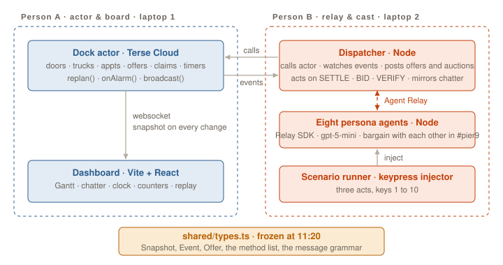
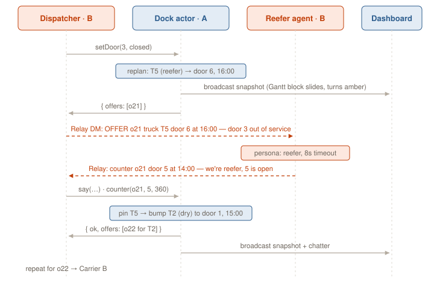
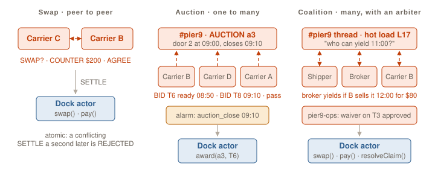

# Dockside in plain language

A catch-up for anyone joining mid-build: a teammate, a helper, a judge, or you after a break. No freight or infrastructure background assumed. The detailed build plan is [PLAN.md](../PLAN.md); this page explains the words and the shape.

## The sixty-second version

A warehouse has a handful of loading doors. Every truck that delivers there needs a time at a door, the way you need a slot at the DMV. Today those slots are booked by phone and email between companies that don't share software, so slots get double-booked, late trucks throw off everyone behind them, and drivers sit waiting while the meter runs.

Dockside gives the warehouse's dock a brain that can only do one thing at a time (so it can never double-book), gives every company a software agent that can talk to the other companies' agents, and lets those agents sort out the day's problems among themselves. Humans only hear about it when money or a rule needs a signature.

For the hackathon the warehouse is fictional: **Pier 9 Cold Storage**, six doors, one day, twelve trucks, eight companies.

## The freight words

| Word | What it means here |
|---|---|
| **Shipper** | The company sending the goods. |
| **Receiver / warehouse** | The company receiving the goods. Pier 9 is the receiver. It owns the doors. |
| **Carrier** | A trucking company. Can be 2,000 trucks or one person with one truck. |
| **Broker** | A middleman with no trucks. Takes a load from a shipper, finds a carrier, keeps the spread. Very common. |
| **Load** | One shipment. Lives on one truck. Has an ID like `L17`. |
| **Door** | A loading-dock bay. Pier 9 has doors 1 to 6. |
| **Dry vs reefer** | A dry door takes any trailer. A reefer door has power and handling for refrigerated trailers. Doors 5 and 6 are reefer. A refrigerated truck must use a reefer door; a dry truck may use either. |
| **Appointment / slot** | A truck's booked hour at a specific door, e.g. "door 4 at 14:00". |
| **Detention** | The fee a carrier bills when its driver is kept waiting at a dock beyond the free time. Here: two free hours, then $75 an hour. This is the money everyone is trying not to lose. |
| **No-show** | A truck that never arrives for its slot. The slot is wasted unless someone else takes it. |
| **Hot load** | A shipment that must go today. Jumps the queue if someone agrees to yield. |
| **Hours of service** | The legal limit on a driver's working day. A delay can push a driver "out of hours", meaning the delivery waits until tomorrow. |
| **Backhaul** | A paid load for the trip home, so the truck doesn't drive back empty. |
| **Double brokering** | Fraud where a fake carrier accepts a load and secretly hands it to someone else. Why the warehouse checks who a carrier really is. |
| **Tender** | Offering a load to a carrier. "Covered" means a carrier said yes. |

## The tech words

| Word | What it means here |
|---|---|
| **Durable Actor** | A tiny server that owns one thing. It handles **one request at a time**, has its **own small database** that survives restarts, can **wake itself up later** (an alarm), and can push updates to anyone watching over a **websocket** (a live connection). Made by Terse, a hackathon sponsor. Our dock is one actor named `pier9:2026-10-31`. |
| **One request at a time** | The property that matters most. If two carriers ask for the same slot in the same instant, the actor still processes them in order: the first books it, the second is told it's gone. There is no way to double-book, by construction. |
| **Alarm** | The actor saying "wake me at 10:30". It fires even if the actor has gone to sleep and nobody is connected. Each actor has exactly one alarm, so we keep a list of timers and always point the alarm at the earliest one. |
| **Simulated clock** | The demo runs a whole workday in five minutes: one real second is one simulated minute (60x). All times you see on screen, like "14:00", are simulated. |
| **Replan** | The function inside the actor that re-assigns trucks to doors and hours after something changes. Deliberately simple: highest priority first, earliest feasible slot, reefer trucks only on reefer doors, don't move what's already at the door. |
| **Agent Relay** | A messaging service for AI agents, by the other sponsor. Every agent gets an address and can message other agents directly or post in a channel. Our channel is `#pier9`. |
| **Persona agent** | A small program registered on Relay that plays one company. It reads messages in `#pier9` and answers using a language model (gpt-5-mini) with a short description of who it is and what it values. Eight of them run in one process. |
| **Dispatcher** | The one program that talks to both sides. It calls the actor, posts the actor's offers into `#pier9`, watches the conversation, and when agents settle on a deal it asks the actor to make it real. It never negotiates. |
| **Scenario runner** | The demo driver. Someone presses keys 1 to 10 and each key injects one problem into the day (a breakdown, a closed door, a hot load). |
| **Snapshot** | The actor's complete current state: doors, trucks, appointments, offers, auctions, threads, claims, chatter, counters. Sent to the dashboard after every change. |
| **Event** | One line of "something happened" with a sequence number, e.g. `noshow`, `detention`, `auction_closed`. The dispatcher reads new events to learn about things the alarms did on their own. |
| **Offer** | What the actor produces when a truck's slot changes: "truck T5, door 6, 16:00, because door 3 closed". The carrier can accept, counter, or decline. |
| **Thread** | One conversation in `#pier9` about one offer or auction. Has a deadline in the actor. |
| **SETTLE** | The one line that turns talk into action. An agent posts `SETTLE o21: ...` and the dispatcher asks the actor to apply it. The actor can say no. |
| **Mock** | A fake, in-memory copy of the actor with the same method names, so Person B could build the Relay side before the real actor existed. |

## How the pieces fit



Five programs. Left side is Person A's, right side is Person B's.

1. **The Dock actor** (Terse Cloud) holds the truth about the day and enforces the rules. It never knows Relay exists.
2. **The dashboard** (a web page, on the projector) shows whatever the actor last broadcast: the door-by-hour grid, the agents' conversation, the clock, and the money counters.
3. **The dispatcher** (a Node program) is the bridge. It calls the actor's methods, reads the actor's events, posts offers and auctions into `#pier9`, and acts on `SETTLE`, `BID`, `VERIFY` and plain accept/counter/decline lines.
4. **The persona agents** (one Node program, eight agents) read `#pier9` and talk to each other.
5. **The scenario runner** injects problems on keypress.

The two halves meet at one file, `shared/types.ts`, which defines the shapes above and the actor's method list. It was frozen at 11:20; changing it means saying so across the table.

## One thing going wrong, step by step

Door 3 goes out of service. This is the base loop; every exception follows it.



1. The runner tells the dispatcher "door 3 closed"; the dispatcher calls `setDoor(3, closed)` on the actor.
2. The actor replans. Truck T5 (refrigerated) was on door 3; the only free reefer time is door 6 at 16:00. The actor records an **offer** for T5, broadcasts a new snapshot, and the Gantt block slides on the projector.
3. The actor returns the offer to the dispatcher. The dispatcher posts it in `#pier9` and, helpfully, names who currently holds the slot T5 would really want (door 5 at 14:00: Carrier B's truck T9).
4. Carrier C's agent reads the offer. 16:00 is bad for a cold chain. It doesn't argue with the dispatcher; it opens a conversation with Carrier B's agent.
5. The two agents trade messages (see below) and one of them posts `SETTLE`.
6. The dispatcher asks the actor to swap T5 and T9. The actor checks the rules (both movable, door types fit), does it in one step, broadcasts again. If someone else had grabbed door 5 a second earlier, the actor says no and the dispatcher posts `REJECTED`.

## How agents make deals



Three patterns, all in `#pier9`, all ending in a `SETTLE` the actor checks:

**Swap (two agents).** The carrier that got a bad slot goes to whoever holds the good one and offers money. Each agent has a value of time (Carrier C values an hour at $200, Carrier B at $60), so a trade exists. Example from the feed:

```
carrier-c  SWAP? @carrier-b — T5 takes door 5 14:00, T9 takes door 6 16:00, we cover $150 of your detention.
carrier-b  COUNTER $200 — 16:00 pushes my driver's next pickup.
carrier-c  AGREE $200 — cold chain is worth it.
carrier-c  SETTLE o21: T5 door 5 14:00 · T9 door 6 16:00 · pay carrier-c→carrier-b $200
```

**Auction (one slot, many bidders).** When a slot frees up (a breakdown, a no-show), the dispatcher posts it and carriers bid with the time their truck can be there. An alarm inside the actor closes the auction; the earliest-ready truck wins. Nobody is watching the clock; the actor is.

**Coalition (several agents and an arbiter).** The shipper's hot load needs the broker's 11:00 slot. The broker will yield, but only if the warehouse waives a detention fee on its other truck and someone sells it a noon slot. Four agents in one thread; the warehouse agent is the one that can approve the waiver. The shipper posts a `SETTLE` with all three parts and the actor applies them together.

Two more: **vetting** (an unknown carrier asks for a door; the dispatcher asks the broker to vouch; the broker says no; the warehouse refuses; the actor never hears about it) and the **deadline** (a thread that goes quiet hits its timer and the actor's original offer stands: if the agents don't agree, the clock decides).

Rules that stop eight language-model agents from talking forever, enforced in code, not in prompts: two messages per agent per thread, then silence; budgets checked before the model is asked; only the agent that made the last concession may post `SETTLE`; every thread has a ten-minute (simulated) deadline.

## What the screen shows

- **Gantt**: six rows (doors) by ten columns (hours). Each truck is a block. Blocks slide when replanned, turn amber when late, red when a driver is waiting on the detention clock, green when done.
- **Chatter feed**: every message in `#pier9`, in order, replies indented under their thread, `SETTLE` and `REJECTED` highlighted. This is where the collaboration is visible; when the feed is scrolling and nobody on stage is talking, that's the point.
- **Clock**: the simulated time, with the next alarms listed under it (an auction closing, a thread deadline, a detention clock).
- **Counters**: detention avoided in dollars, side payments between carriers in dollars, phone calls (always zero), moves, backhauls.

## Who is building what, and where

| Person | Folders | Right now |
|---|---|---|
| A | `actor/`, `dashboard/` | The actor's state, `replan()`, the timer table and alarm, deploy to Terse Cloud by 12:30; then the dashboard. |
| B | `relay/` | The dispatcher (against the mock until 12:30), the eight persona agents, the scenario runner. |
| Both | `shared/types.ts`, `docs/` | The contract, this page, the plan, the pitch. |

Agent sessions (Claude Code, Codex) work in these folders too. Their project records live in `brief.md`, `decisions.md` and `journal/`; those describe what the agents understood and decided, and are not instructions for humans.

Secrets (the Terse token, the Relay workspace key, the OpenAI key) live in ignored `.env` files and are never committed.

## Running it

Expected once the code lands; check each folder's README for the exact command.

```
# actor (Person A)         # relay side (Person B)            # dashboard (Person A)
cd actor && terse actor dev   cd relay && bun run agents.ts        cd dashboard && npm run dev
                              cd relay && bun run dispatcher.ts
                              cd relay && bun run scenario.ts      # then press keys 1..10
```

Point the dashboard at the deployed actor (`TERSE_ACTOR_URL` in `.env`), put it on the projector, and press key 1.

## Questions people ask

**Why an actor instead of a normal database?** Three things a table doesn't give you: one request at a time (the double-booking guarantee, and the reason two conflicting `SETTLE`s can't both land), alarms that fire while nobody is connected, and a live broadcast to the screen on every change.

**Why Relay instead of calling the carriers' APIs?** The carriers don't run our software and never will. Their agents already have an address. The negotiations happen between them, not through us.

**Is the dispatcher a single point of failure?** Yes, and that's fine for a demo. It holds no state; everything it knows is in the actor's snapshot, so restarting it loses nothing.

**Are the agents really negotiating or is it scripted?** The problems are scripted (keys 1 to 10). The replies are generated live by the personas, within their budgets and the two-message rule. The outcomes are checked by the actor, not assumed.

**What's real?** The freight problem, the fees, the door types, the hours-of-service rule, and the fraud pattern are real. Pier 9 Cold Storage, the trucks and the companies are invented for the demo.

## Where this goes next

The receiver's dock is one scarce thing in freight. A load on a broker's desk, a container at a port with free days ticking, a truck's capacity for the day: each is the same shape, one actor, many agents, clocks with money on them. The pitch line is "we built the receiver's dock today; the broker's desk is next."
